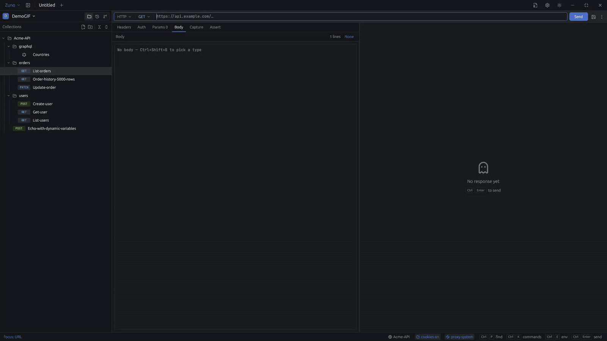

# Zuno

A ridiculously fast API client. Native, keyboard-driven, local-first — built in Rust on
[GPUI](https://crates.io/crates/gpui).

Postman-level capability, Zed-level feel: a virtualized response viewer that holds 60fps on
multi-megabyte JSON, request tabs as editor buffers, curl import, response diffing, and
collections stored as one file per request so they live in git like anything else you own.

<p align="center">
  <a href="https://github.com/aryanjha256/zuno/actions/workflows/rust.yml"></a>
  <a href="https://github.com/aryanjha256/zuno/actions/workflows/release.yml"></a>
  <a href="https://github.com/aryanjha256/zuno/releases/latest"></a>
  <a href="https://github.com/aryanjha256/zuno/releases"></a>
  
  <a href="LICENSE"></a>
</p>



## What it does

- **Every kind of API:** HTTP, GraphQL (schema-aware completion and validation, subscriptions),
  WebSocket, server-sent events and gRPC (all four call shapes).
- **Keyboard first:** Ctrl+P jumps to any request by name or URL, Ctrl+Enter sends, Ctrl+K lists
  every command.
- **Fast with big responses:** a virtualized JSON viewer that folds, searches and scrolls
  multi-megabyte bodies without stalling.
- **Your requests are files:** one file per request, in folders you can commit. A git panel
  commits, syncs and shows what changed in a request since the last commit.
- **Bring what you have:** import Postman collections and environments, OpenAPI 3 specs (JSON or
  YAML) and curl commands. Export to Postman or a Zuno bundle.
- **Environments and variables,** with secrets kept in a gitignored file, plus captures and
  assertions to chain requests and a runner for a whole collection.
- **See what really happened:** timing, connection and certificate details, the request exactly
  as sent, cookies, and a diff against the previous response.
- **No account, no cloud.** Linux, macOS and Windows.

## Keyboard

Ctrl on Linux and Windows, ⌘ on macOS.

| Key | Does |
|---|---|
| Ctrl+P | Open a request by name or URL |
| Ctrl+Enter | Send |
| Ctrl+K | Every command |
| Ctrl+L | Focus the URL |
| Ctrl+S | Save |
| Ctrl+E | Switch environment |
| Ctrl+F | Find in the response |
| Ctrl+Shift+X | Copy as code |
| Ctrl+Shift+I | Import Postman, OpenAPI or curl |
| Alt+H / Alt+G | History / Git |

## Install

```bash
curl -fsSL https://raw.githubusercontent.com/aryanjha256/zuno/main/scripts/install.sh | sh
```

The same command installs Zuno and updates it — run it again whenever you want the latest.
It downloads from the latest release and verifies the checksum, then:

- **on Debian, Ubuntu and derivatives** it installs the `.deb` with `apt-get`, asking for
  `sudo` only at that last step;
- **everywhere else** — Fedora, openSUSE, Arch — it unpacks the tarball into `~/.local`, with
  no `sudo` at all;
- **on a Mac with Apple Silicon** it installs `Zuno.app` into `/Applications`, asking for
  `sudo` only if your account cannot write there.

**On Windows**, in PowerShell:

```powershell
irm https://raw.githubusercontent.com/aryanjha256/zuno/main/scripts/install.ps1 | iex
```

It installs for your user only — no admin rights — into `%LOCALAPPDATA%\Programs\Zuno`, and adds
Zuno to the Start menu, the desktop, your `PATH` and **Settings → Apps**, whose Uninstall button
removes all of it again. Run it again to update.

On macOS and Windows, use the command rather than downloading the archive in a browser. Zuno is
not yet notarized or code-signed, so macOS blocks it and Windows SmartScreen warns about it when a
browser downloaded it; installed by the command it opens normally.

`ZUNO_VERSION=0.2.4` pins a specific release if you need to go back, and `ZUNO_METHOD=tarball`
takes the no-`sudo` route on Debian too.

<details>
<summary>Or install the <code>.deb</code> by hand</summary>

Download it from the [latest release](https://github.com/aryanjha256/zuno/releases/latest):

```bash
sudo apt install ./zuno_*_amd64.deb
```

Use `apt install ./file.deb` rather than `dpkg -i` — apt resolves the runtime dependencies,
`dpkg` does not.

</details>

<details>
<summary>Or unpack the tarball by hand</summary>

```bash
tar -xzf zuno-*-x86_64-linux.tar.gz --strip-components=1 -C ~/.local
```

It needs `libxkbcommon`, `libxkbcommon-x11` and `libxcb`, which every desktop already has.

</details>

<details>
<summary>Or run the AppImage — one file, nothing installed</summary>

```bash
chmod +x Zuno-*-x86_64.AppImage && ./Zuno-*-x86_64.AppImage
```

It needs FUSE, which desktop systems have; where it is missing, run it with
`--appimage-extract-and-run`.

</details>

**Requirements:** x86-64 Linux with glibc 2.35+ — Ubuntu 22.04+, Debian 12+, Fedora 36+, or
anything as recent. Zuno renders through Vulkan, so on a machine with no GPU driver installed
you also want one: `mesa-vulkan-drivers` on Debian and Fedora — apt suggests it with the
`.deb`, but only installs it if you accept recommends. On macOS: Apple Silicon, macOS 11 or
later. On Windows: 64-bit Windows 10 or 11.

## Build from source

```bash
sudo apt install libxcb1-dev libxkbcommon-dev libxkbcommon-x11-dev
cargo run --release
```

`--release` matters — a debug build starts roughly 4× slower, which is a bad way to judge
how the app feels.

To build the package itself:

```bash
cargo install cargo-deb --locked
cargo deb -p zuno
```

## Documentation

- [`CHANGELOG.md`](CHANGELOG.md) — what changed in each release.
- [`ROADMAP.md`](ROADMAP.md) — what's next and why in that order.
- [`architecture.md`](architecture.md) — how it works, and what was tried and abandoned.

## License

[GPL-3.0-or-later](LICENSE).
